<p align="center">
  
</p>

# RadarVila

**Painel de inteligência territorial que antecipa riscos de água, energia e clima na Vila Mariana (SP) — com alertas transparentes e decisão sempre humana.**

---

## 1. Problema e público

**Problema.** Bairros densos como a Vila Mariana sofrem com eventos que poderiam ser antecipados: aumento de consumo de água em períodos quentes (risco de desabastecimento), perdas na rede por vazamentos, picos de demanda de energia que derrubam a rede local, ondas de calor e chuvas fortes que causam alagamentos. Hoje essas informações ficam espalhadas e chegam tarde a quem decide.

**Público.**
- **Gestores públicos** (subprefeitura, Defesa Civil, concessionárias): acompanham indicadores, recebem alertas com justificativa e registram a decisão tomada.
- **Cidadãos**: entendem os riscos em linguagem simples e registram ocorrências (vazamento, falta de água, alagamento) de forma anônima.

**Impacto social esperado.** Reduzir desperdício de água, antecipar ações de saúde em ondas de calor, prevenir alagamentos e quedas de energia, e aumentar a participação cidadã. O app exibe um indicador de benefício: litros/semana que poderiam ser economizados e quantas pessoas esse volume abasteceria por dia (referência ONU: 110 L/pessoa/dia).

---

## 2. Integrantes

| Nome completo | RM |
|---|---|
| Ana Luiza Santos Bertão | 563171 |
| Sofia Bill Franken | 562767 |
| Leonardo Luster Gomes | 564448 |

---

## 3. Demonstração visual

> Prints salvos em `assets/screenshots/`.

| | | |
|:---:|:---:|:---:|
| 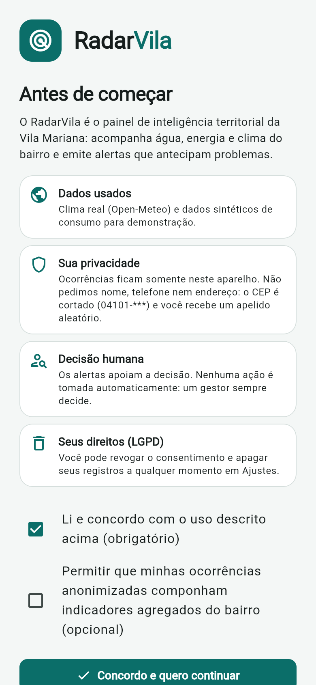<br>**Consentimento (LGPD)** | 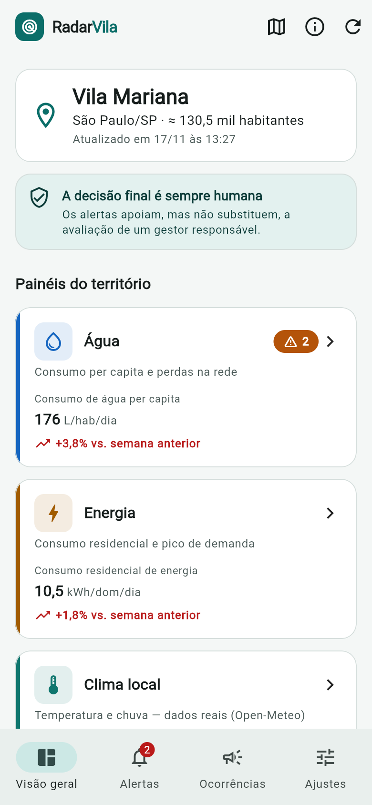<br>**Visão geral do território** | 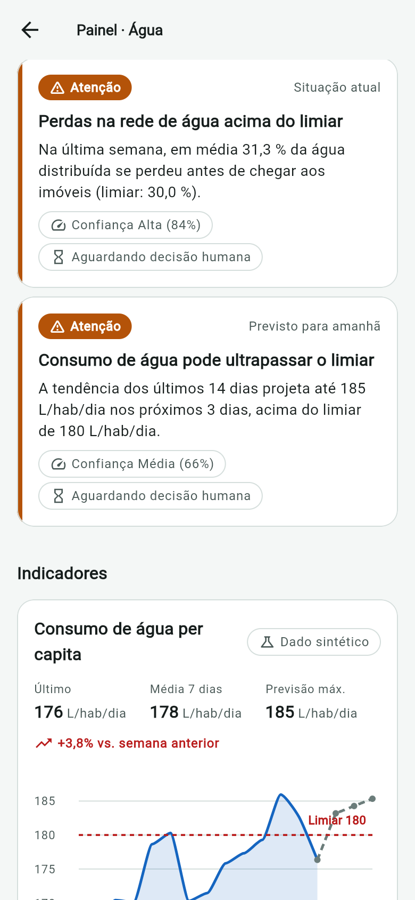<br>**Dashboard de Água** |
| 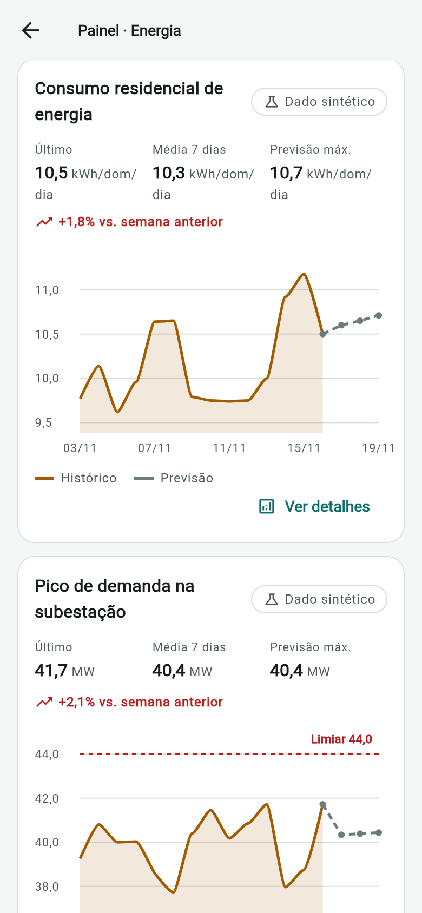<br>**Dashboard de Energia** | 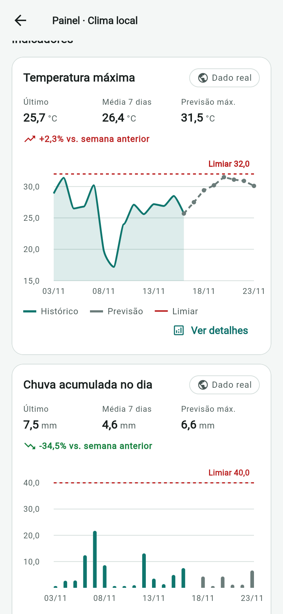<br>**Dashboard de Clima (dados reais)** | 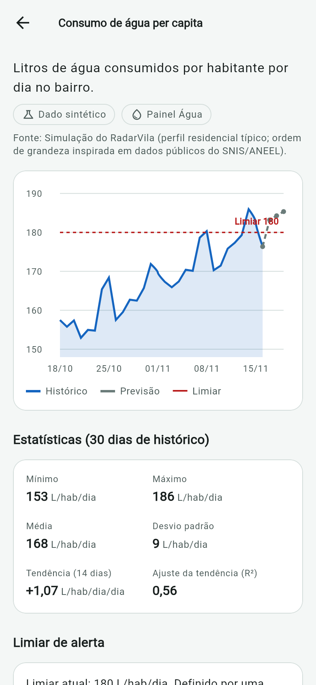<br>**Detalhe do indicador** |
| 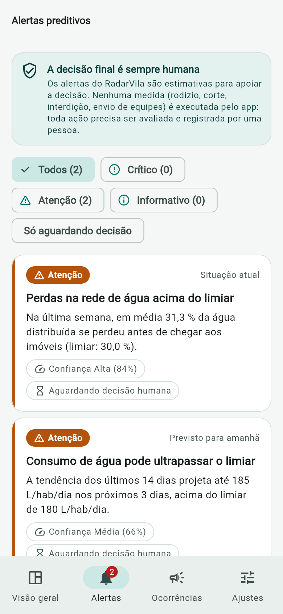<br>**Lista de alertas com filtros** | 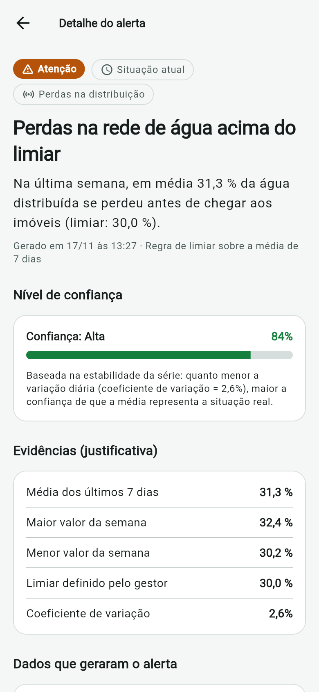<br>**Alerta: evidências, confiança e limitações** | 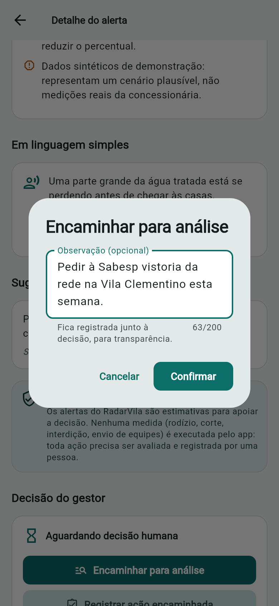<br>**Registro da decisão humana** |
| 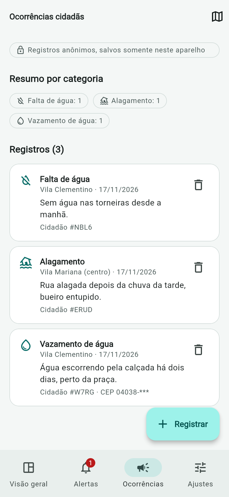<br>**Ocorrências cidadãs** | 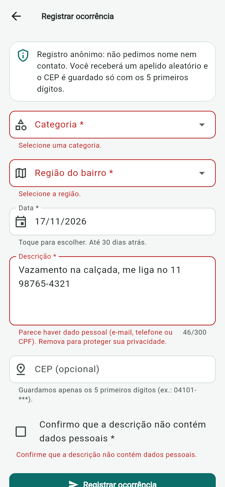<br>**Formulário com validação** | 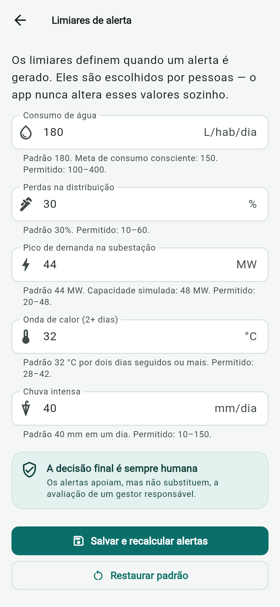<br>**Configuração de limiares** |
| 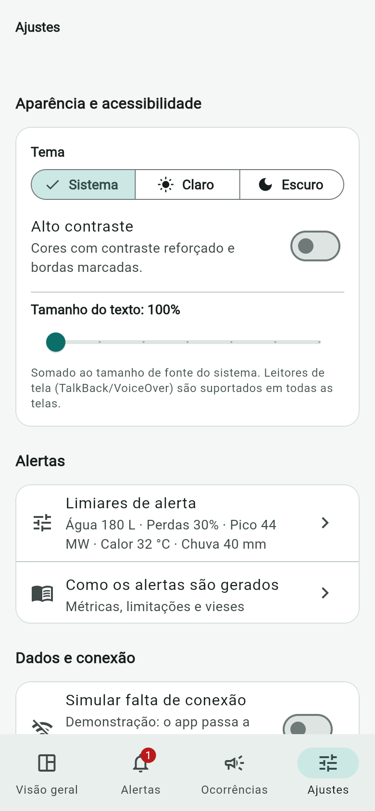<br>**Ajustes e acessibilidade** | 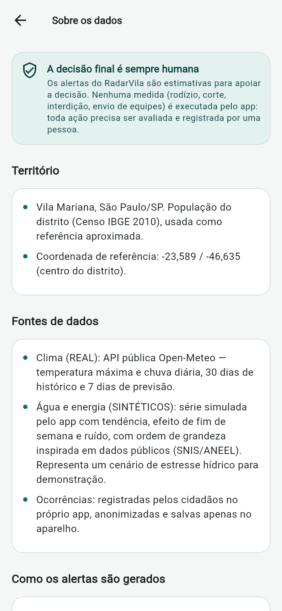<br>**Sobre os dados e limitações** | 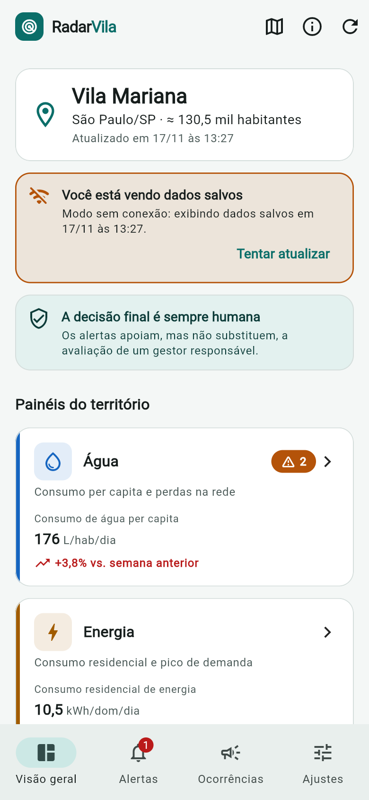<br>**Modo sem conexão (cache)** |
| 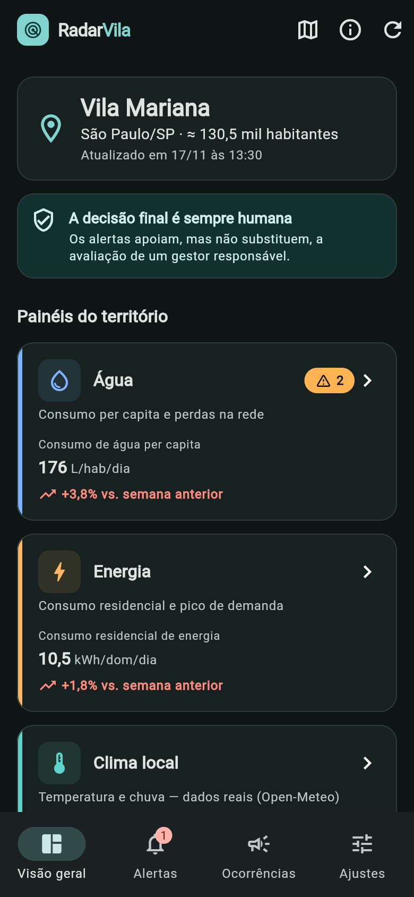<br>**Modo escuro** | 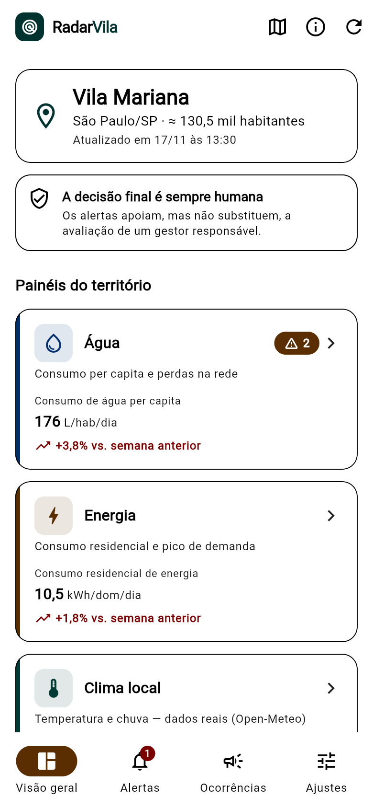<br>**Alto contraste** | 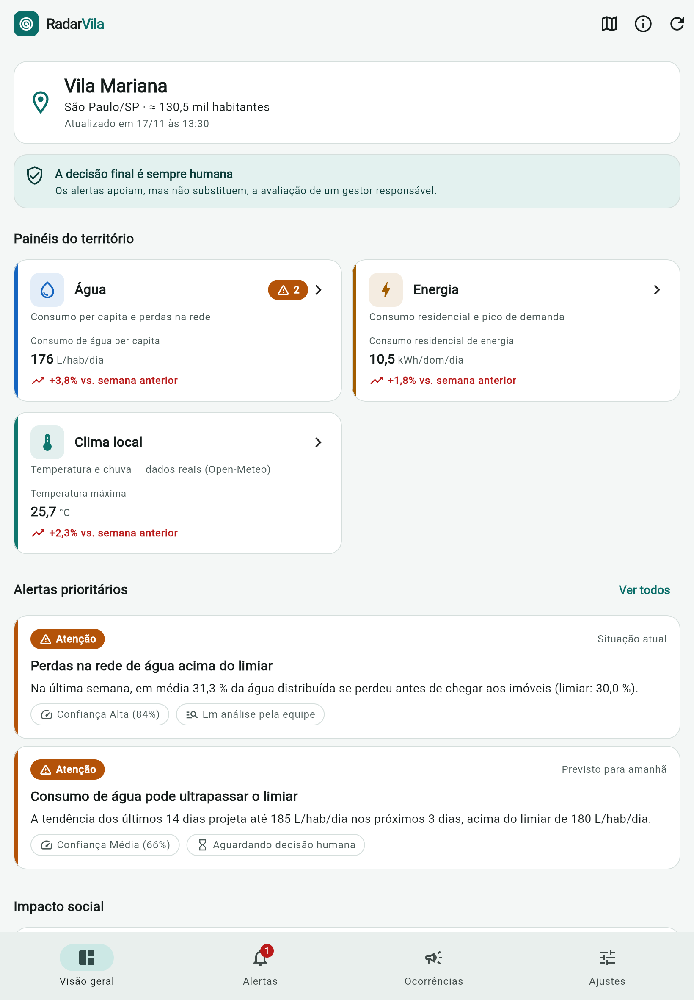<br>**Layout em tablet** |
| 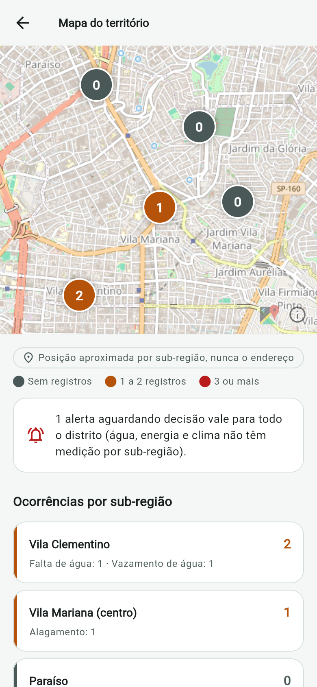<br>**Mapa de ocorrências por sub-região** | | |

---

## 4. Funcionalidades

- [x] 12 telas com rotas nomeadas e passagem de parâmetros (visão geral → dashboard → indicador → alerta)
- [x] 3 dashboards territoriais (Água, Energia, Clima) com gráficos de histórico, previsão e linha de limiar
- [x] Seletor de período (7/14/30 dias), cards de KPI e variação semanal
- [x] Alertas preditivos por regressão linear, regra de limiar, previsão meteorológica e detecção de anomalia
- [x] Cada alerta mostra **evidências**, **nível de confiança** (com explicação do cálculo), **limitações** e explicação em linguagem simples
- [x] Aviso visível de que os alertas não substituem a decisão humana
- [x] Registro da decisão do gestor (em análise / ação encaminhada / descartado), com justificativa obrigatória para encaminhar ou descartar
- [x] Estado global (Provider) compartilhado entre visão geral, dashboards, detalhes e alertas
- [x] Estados de carregamento, erro (com "tentar novamente") e lista vazia em todas as telas de dados
- [x] Dados reais da API Open-Meteo + API simulada de consumo
- [x] Persistência local: cache dos dados, ocorrências, limiares, decisões, consentimento e preferências
- [x] Funciona sem conexão (cache) + modo "simular falta de conexão" para demonstração
- [x] Formulário de ocorrência com validação, bloqueio de dados pessoais e mensagens de erro claras
- [x] Formulário de limiares com validação de intervalo
- [x] Indicador de benefício social
- [x] Tema próprio com componentes reutilizáveis, modo escuro e alto contraste
- [x] Ajuste de tamanho de fonte, rótulos para leitores de tela, severidade por ícone + texto (não só cor)
- [x] Consentimento explícito, anonimização e direito de apagar dados
- [x] Layout responsivo (1 a 3 colunas)
- [x] Mapa (OpenStreetMap) com as ocorrências por sub-região, sempre em posição aproximada
- [x] Aviso no app quando surge um novo alerta crítico, com atalho para a justificativa
- [x] Animações com propósito (troca de estado, barra de confiança, marcador selecionado), desligadas quando o sistema pede menos movimento
- [x] Testes automatizados de unidade e de widget

**Diferenciais implementados:** dados reais (Open-Meteo) · mapa por região · aviso de alerta crítico no app · animações · modo escuro e alto contraste · testes automatizados · [APK de release](https://github.com/sofiafrankenn/radar_vila/releases/tag/v1.0.0).

---

## 5. Dados e alertas

### Fontes

| Indicador | Origem | Fonte |
|---|---|---|
| Temperatura máxima diária | **Real** | [Open-Meteo](https://open-meteo.com) — 30 dias de histórico + 7 de previsão |
| Chuva diária | **Real** | Open-Meteo |
| Consumo de água (L/hab/dia) | Sintético | Gerado pelo app (`SyntheticDataService`) |
| Perdas na distribuição (%) | Sintético | Gerado pelo app |
| Consumo de energia (kWh/domicílio/dia) | Sintético | Gerado pelo app |
| Pico de demanda na subestação (MW) | Sintético | Gerado pelo app |

Os dados sintéticos são determinísticos (mesma data = mesmo valor), com tendência, efeito de fim de semana e ruído, e ordem de grandeza inspirada em dados públicos do SNIS e da ANEEL. Representam um cenário de estresse hídrico para demonstração e estão identificados no app com o selo **"Dado sintético"**.

### Como os alertas são gerados (`lib/domain/alert_engine.dart`)

| Regra | Indicadores | Lógica |
|---|---|---|
| Regressão linear | Consumo de água, pico de energia | Reta ajustada aos últimos 14 dias, projetada 3 dias. Alerta se a projeção ou o último valor passar do limiar. |
| Regra de limiar | Perdas na rede | Média dos últimos 7 dias acima do limiar. |
| Previsão meteorológica | Temperatura, chuva | 2+ dias seguidos acima do limiar de calor; 1 dia acima do limiar de chuva. |
| Anomalia (z-score) | Todos, exceto chuva | Último valor com \|z\| ≥ 2,5 em relação aos 14 dias anteriores. |

Os **limiares são definidos por pessoas** na tela de limiares; o app nunca os altera sozinho.

### Métricas e confiança

- Média móvel de 7 dias, variação semanal, mínimo, máximo, desvio padrão, inclinação e **R²**.
- Confiança:
  - Tendência: `15% + 55% × R² + 30% × (dias de histórico ÷ 21)`
  - Perdas: `92% − 3 × coeficiente de variação`
  - Calor: `92% − 7 pontos por dia de antecedência`; chuva: `80% − 8 pontos por dia`
  - Anomalia: no máximo 35%
  - Dados em cache: confiança × 0,75
  - Faixas: **Alta** ≥ 70%, **Média** ≥ 40%, **Baixa** < 40%

### Limitações e possíveis vieses

- Dados de consumo são sintéticos e não substituem medições da concessionária.
- A previsão meteorológica vem de um único ponto; microclimas (ilhas de calor, fundos de vale) não são capturados.
- **Viés de subnotificação**: moradores com menos acesso digital registram menos ocorrências, o que pode concentrar a atenção em áreas mais conectadas.
- A regressão linear não modela sazonalidade longa, feriados ou eventos extremos.

### Quando as previsões não são confiáveis

- R² abaixo de 0,4 (o próprio alerta avisa).
- Menos de 7 dias de histórico (o alerta não é gerado).
- Dados em cache ou com mais de 24 h.
- Horizonte acima de 3 dias (tendência) ou 5 dias (clima).
- Eventos atípicos: obras, feriados, falhas de medição.

### Decisão humana

Nenhuma ação é executada automaticamente. Cada alerta traz uma *sugestão para avaliação* e só muda de status quando um gestor registra a decisão, com justificativa obrigatória para "ação encaminhada" e "descartado".

---

## 6. Privacidade e inclusão

**Privacidade (LGPD)**
- Tela de consentimento explícito na primeira abertura, com consentimento opcional separado para uso agregado.
- Consentimento revogável em Ajustes; ao revogar, as ocorrências são apagadas.
- O app **não coleta nome, telefone, e-mail nem endereço**. O cidadão recebe um apelido aleatório (`Cidadão #K7QX`).
- CEP opcional, truncado para os 5 primeiros dígitos (`04101-***`); localização apenas por sub-região.
- A descrição é bloqueada se contiver e-mail, telefone ou CPF.
- As ocorrências ficam só no aparelho. O app apenas baixa dados públicos de clima (Open-Meteo) e do mapa (OpenStreetMap), sem enviar dados pessoais.

**Acessibilidade**
- Paletas com contraste verificado e tema de **alto contraste** (claro e escuro).
- **Modo escuro**.
- Ajuste de tamanho de fonte no app (até 160%), somado à fonte do sistema.
- `Semantics` em cards, gráficos (resumo textual), chips, medidores e botões; cabeçalhos marcados como `header`.
- Severidade indicada por **cor + ícone + texto**.
- As animações são desligadas quando o sistema pede menos movimento.
- Alvos de toque com no mínimo 48 dp.
- Layout responsivo testado em celular e tablet.

---

## 7. Tecnologias e decisões técnicas

| Escolha | Justificativa |
|---|---|
| **Flutter 3.50 + Material 3** | Uma base de código para Android e iOS; componentes acessíveis por padrão. |
| **material_ui / cupertino_ui** | A partir do Flutter 3.50 os componentes Material e Cupertino são pacotes separados; usá-los evita as APIs descontinuadas. |
| **Provider** | Simples e oficial para separar estado global (`SettingsProvider`, `TerritoryProvider`, `OccurrenceProvider`) de estado local (filtros, período, formulários em `StatefulWidget`). |
| **http** | Cliente leve para consumir a API Open-Meteo. |
| **shared_preferences** | Persistência local suficiente para cache, ocorrências, limiares e preferências, sem servidor. |
| **fl_chart** | Gráficos de linha e barras customizáveis, com tooltip e linha de limiar. |
| **flutter_map + latlong2** | Mapa com tiles do OpenStreetMap, sem chave de API, para mostrar as ocorrências por sub-região. |
| **flutter_localizations** | Datas e componentes em pt-BR. |
| **Open-Meteo** | API pública real, gratuita e sem chave — nenhuma credencial no repositório. |
| **ThemeExtension (`AppPalette`)** | Cores semânticas por tema (claro, escuro, alto contraste) sem estilos repetidos. |
| **Rotas nomeadas + `onGenerateRoute`** | Navegação centralizada, com validação dos parâmetros recebidos. |
| **Motor de alertas em Dart puro** | Independente da interface, testável com testes de unidade. |

**Arquitetura em camadas**

```
lib/
├── core/            # tema, tokens, formatação, validação, anonimização
├── models/          # entidades (Indicator, TerritoryAlert, Occurrence, Thresholds…)
├── domain/          # estatística, motor de alertas, impacto social
├── data/            # serviços (API real e simulada), repositórios, cache local
├── providers/       # estado global (Provider)
├── routes/          # rotas nomeadas
├── widgets/         # componentes reutilizáveis
└── screens/         # telas
```

Fluxo: `Serviços → Repositório (cache/offline) → Provider → Telas`. O `AlertEngine` recebe indicadores + limiares e devolve alertas; ele nunca altera dados nem toma decisões.

---

## 8. Como executar

**Pré-requisitos:** Flutter 3.50 ou superior, Android Studio ou VS Code, emulador ou celular.

```bash
# 1. Clonar
git clone https://github.com/sofiafrankenn/radar_vila.git
cd radar_vila

# 2. Instalar dependências
flutter pub get

# 3. Rodar
flutter run

# 4. Testes
flutter test
```

**Variáveis de ambiente (opcional).** O app não precisa de chave de API. Para trocar a URL da API de clima:

```bash
flutter run --dart-define=CLIMATE_API_URL=https://api.open-meteo.com/v1/forecast
```

**APK de release.** O APK pronto para instalar está em [Releases](https://github.com/sofiafrankenn/radar_vila/releases/tag/v1.0.0) (Android 7.0 ou superior). Para gerar o seu:

```bash
flutter build apk --release
```

**Dica para a demonstração.** Em *Ajustes → Simular falta de conexão*, o app passa a usar o cache. Em *Limiares*, reduzir o pico de energia para 40 MW gera um novo alerta na hora.

---

## 9. Vídeo

<a href="https://youtube.com/shorts/6f6wZs6xw2o"></a>

▶️ **[Assista à demonstração](https://youtube.com/shorts/6f6wZs6xw2o)**

---

## 10. Licença

Projeto acadêmico desenvolvido para a **FIAP — Global Solution 2026.2**, disciplina *Cross-Platform Application Development*, desafio *Territory Predictive Insights*. Uso educacional.
